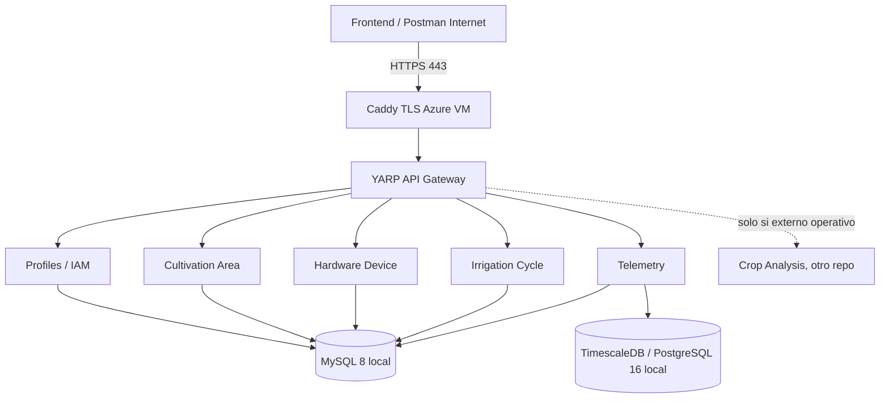

# Grotix — Despliegue en Azure VM (Ubuntu, Docker y Caddy HTTPS)

> Guía para una **primera demo académica** de una sola VM. No crea ni paga recursos automáticamente. Se requiere una suscripción Azure, una IP pública, DNS, credenciales nuevas y ejecutar los comandos en la VM. La disponibilidad, backups y escalabilidad de una sola VM son limitadas.

## Arquitectura



La arquitectura DDD por bounded contexts y el servicio Crop Analysis quedan intactos. Al iniciar, todos los servicios utilizan una misma red Docker interna. Gateway publica solo `127.0.0.1:5100`; Caddy publica `80/443` desde la VM. Puertos `3307`, `5433` y `15672` (si se usa RabbitMQ) se limitan a loopback.

## A. Recursos de Azure (pasos en Portal)

1. Crear una VM Linux Ubuntu 24.04 LTS con espacio SSD suficiente para imágenes, DB y logs. Para compilar localmente seis contenedores y el migrador en la misma VM, **se recomienda dimensionar RAM y disco con margen** (p. ej. 4 vCPU/8–16 GiB y al menos 64 GiB de SSD para una demo pequeña; estimaciones, no benchmarks).
2. Asociar IP pública estática y crear registro **DNS A** para `api.tudominio.com`. Comprobar propagación desde Internet antes de HTTPS.
3. NSG / firewall: permitir TCP **80 y 443** desde Internet; TCP **22 únicamente desde tu IP de administración**. No exponer 3306, 3307, 5432, 5433, 5672, 15672 ni 5100.
4. Instalar Docker Engine y `docker compose` plugin v2 desde documentación oficial. Agregar el usuario autorizado al grupo `docker` solo si lo comprendes: concede privilegios equivalentes a root.
5. Acceder con SSH por clave y clonar **la rama aprobada con los últimos cambios** de `Aguagro/grotix-platform-api`. No desplegar el repo antiguo si aún no se fusionaron los fixes.

## B. Preparar entorno privado en VM

```bash
git clone https://github.com/Aguagro/grotix-platform-api.git
cd grotix-platform-api
bash scripts/init-env.sh azure-vm
nano .env
chmod 600 .env
```

**Modificar:**
- `GROTIX_DOMAIN`: el FQDN real apuntando a la IP pública de la VM.
- `CORS_ALLOWED_ORIGIN`: URL HTTPS real del frontend, sin `/` final (NO `*`).
- `BOOTSTRAP_ADMIN_EMAIL`: una dirección de administrador controlada por el equipo.
- `JWT_SECRET`, `MYSQL_*`, `POSTGRES_*` y `BOOTSTRAP_ADMIN_PASSWORD` ya se generaron aleatoriamente. No poner contraseñas de prueba públicas ni imprimir el `.env` en logs. Mantener `GROTIX_DATABASE_MODE=vm`.
- `MYSQL_HOST=mysql`, `POSTGRES_HOST=postgres`; `MYSQL_SSL_MODE=Disabled`, `POSTGRES_SSL_MODE=Disable` solo para la red Docker privada de una VM. Con bases administradas **externas**, usar `.env.example`, `GROTIX_DATABASE_MODE=external`, TLS verificado, sin Compose de bases.
- Para una primera compilación directa desde el repo, dejar `IMAGE_PREFIX=grotix-` y `IMAGE_TAG=local`. GHCR se habilita después de publicar releases.

Una contraseña de administrador de bootstrap **solo** debe estar durante el primer arranque; quitarla de `.env` y recrear profiles tras comprobar login. Eliminar las variables vacías es seguro: Compose usa valores vacíos por defecto.

## C. Bases y migraciones (primera vez, BD vacía)

```bash
# Validar YAML, variables y contenedores
 docker compose -f docker-compose.yml -f docker-compose.databases.yml -f docker-compose.migrations.yml config --quiet
 docker compose -f docker-compose.yml -f docker-compose.databases.yml up -d mysql postgres
 docker compose -f docker-compose.yml -f docker-compose.databases.yml ps

# EF en contenedor dotnet/sdk:10.0 + dotnet-ef:9.0.23, sin instalar .NET en la VM.
# OJO: 'apply' modifica los esquemas. Usarlo solo después de revisar/listar.
 docker compose -f docker-compose.yml -f docker-compose.databases.yml -f docker-compose.migrations.yml run --rm --build migrator list
 docker compose -f docker-compose.yml -f docker-compose.databases.yml -f docker-compose.migrations.yml run --rm migrator check-model
 docker compose -f docker-compose.yml -f docker-compose.databases.yml -f docker-compose.migrations.yml run --rm migrator apply
```

El orden de los seis contextos es **Profiles → IAM → Cultivation Area → Hardware Device → Irrigation Cycle → Telemetry**. En BD ya pobladas, primero inspeccionar cambios y hacer backups: `bash scripts/backup-local-databases.sh`. Es indispensable probar restauración para disponer de recuperación real; el script solo genera dumps, no comprueba la restauración. No ejecutar `apply` en cada reinicio ni en paralelo con otras instancias.

Al terminar, opcionalmente `migrator list` confirma que ninguna migración está pendiente. Para DB administradas externas, la misma imagen migrator conecta por TLS a los servidores remotos a través de las variables `.env`. **Verifica reglas de red y permisos antes de aplicar.**

## D. Primer despliegue manual con código del repositorio

```bash
# Se descargan las dependencias .NET dentro de las imágenes Docker al construir.
docker compose -f docker-compose.yml -f docker-compose.databases.yml --profile public up -d --build
 docker compose -f docker-compose.yml -f docker-compose.databases.yml --profile public ps
 bash scripts/smoke-test.sh http://localhost:5100
```

Caddy obtiene y renueva certificados TLS automáticamente **si DNS y puertos 80/443 funcionan**. Cuando el DNS esté resuelto y el certificado emitido:

```bash
curl -fsS https://api.tudominio.com/live
curl -i https://api.tudominio.com/ready/core
curl -i https://api.tudominio.com/ready/telemetry
```

Con `SWAGGER_ENABLED=true` (solo demo/red controlada), comprobar OpenAPI JSON en `/docs/profiles/openapi.json` y `/docs/irrigation/openapi.json`. Recomendación producción: `false`.

Para crear la cuenta inicial el servicio Profiles requiere una clave que cumpla las reglas: 8+ caracteres, mayúscula, número y uno de `@$!%*?&`. El generador incluido sí las cumple. Tras el primer login, eliminar BOOTSTRAP_ADMIN_EMAIL y BOOTSTRAP_ADMIN_PASSWORD de `.env` y ejecutar:

```bash
docker compose -f docker-compose.yml -f docker-compose.databases.yml up -d --no-deps --force-recreate profiles
```

La identidad queda almacenada en MySQL. Para futuras rotaciones de contraseña usar el flujo seguro de cuenta de la aplicación; modificar la variable bootstrap NO cambia la contraseña existente.

## E. Preparación GitHub y releases GHCR

1. Subir **solo archivos fuente del ZIP descomprimido**, no el ZIP ni `.env`, `backups/`, `*.bak`, `bin/`, `obj/`.
2. Abrir PR desde `feature/backend-deployment` a `develop` y de allí hacer release a `main` según GitFlow del equipo. Confirmar el workflow `Backend CI` en GitHub: compila .NET 10 y ejecuta todos los tests.
3. Tras aprobar la release, crear un tag SemVer **real**, p. ej. `v1.0.0` (no reutilizar este tag si ya existe):

```bash
git tag v1.0.0
git push origin v1.0.0
```

4. GitHub Actions `Publish backend images (GHCR)` publica `ghcr.io/aguagro/grotix-{gateway,profiles,cultivation,telemetry,hardware,irrigation}:v1.0.0`. Confirmar que el workflow tuvo éxito y los paquetes GHCR existen.
5. En la VM, si los paquetes son **privados**, iniciar sesión en GHCR con un token de lectura (`read:packages`) mediante mecanismo seguro; si son públicos no se necesita token para `pull`.
6. En GitHub crear un **Environment `production`** con aprobación manual cuando sea posible. Configurar estos Secrets:

| Secret | Significado |
| --- | --- |
| `AZURE_VM_HOST` | IP o dominio de administración SSH de la VM |
| `AZURE_VM_USER` | Usuario Linux con acceso Docker |
| `AZURE_VM_SSH_KEY` | Llave privada SSH exclusiva para despliegue |
| `AZURE_VM_KNOWN_HOSTS` | Llave pública de host verificada (NO aceptar sin comprobar huella) |
| `AZURE_VM_REPO_PATH` | Ruta absoluta de este repo en la VM, actualizado a la release |

7. En la VM ejecutar `git pull`/checkout de la release **antes** del workflow (o configurar un mecanismo confiable para sincronizar los scripts). Las imágenes se obtienen de GHCR, pero Compose/scripts requieren coincidir con el tag.
8. En Actions ejecutar `Deploy to Azure VM (manual)` con el tag publicado. `scripts/deploy-release.sh` descarga solo las imágenes de API y Caddy, sin actualizar ni borrar volúmenes ni aplicar migraciones. Verifica readiness **interno**; validar HTTPS público por separado.

Ejemplo de ejecución manual en VM si no deseas usar GitHub Actions:

```bash
bash scripts/deploy-release.sh ghcr.io/aguagro/grotix- v1.0.0
```

**Nota:** el script permite `GROTIX_DATABASE_MODE=vm` o `external` según `.env`. No hace auto-migration. Si un cambio de release requiere migración, revisar y aplicar antes de actualizar imágenes, con backup y plan de reversión. Mantener el tag anterior para rollback.

## F. Finalización y evidencia

- Verificar `docker compose ps`: 6 APIs y 2 DB; Caddy activo.
- GET `/live`, `/ready/core`, `/ready/telemetry`, rutas de salud de hardware/riego/telemetría y OpenAPI (solo demo).
- POST autenticación y GET perfil; probar un CRUD real con token de prueba y comprobar persistencia.
- Confirmar rol, permisos, CORS, JWT aleatorio, HTTPS válido, logs sin secretos, backups.
- El módulo Crop Analysis queda **pendiente de integrar**: configurarlo únicamente si el servicio externo está desplegado y accesible por la red apropiada.
- Con RabbitMQ deshabilitado, las rutas HTTP funcionan pero no se afirma que los flujos asíncronos estén operativos; si la rúbrica exige eventos, habilitar y probar broker privado.
- Registrar capturas reales: VM, NSG, URL HTTPS, `docker compose ps`, commit, PR, Actions, migraciones y Postman. **No adjuntar contraseñas ni hashes en el reporte.**

## G. Troubleshooting básico

- `port is already allocated`: cambiar `MYSQL_PUBLISHED_PORT` (3307 predeterminado), `POSTGRES_PUBLISHED_PORT` (5433) o identificar proceso bloqueante. **No** cambiar puertos internos 3306/5432.
- `401 Unauthorized` tras bootstrap: revisar strength de contraseña; si la cuenta ya existe, bootstrap NO resetea contraseña. Revisar logs `profiles` sin publicar secretos.
- `502` HTTPS: comprobar que Gateway/API arranquen, red, logs de Caddy.
- `readiness 503`: comprobar conexión a DB, migraciones y permisos.
- `error EF pending model changes`: con el snapshot de `AnalysisReport` corregido no debería persistir. Confirmar `migrator check-model`, no ejecutar migrations add a ciegas.
- `docker compose config` falla: `GROTIX_DOMAIN`/`JWT_SECRET`/credenciales ausentes; generar `.env` con los scripts y completar dominio.
- Docker daemon error: iniciar Docker/Compose antes de ejecutar.
